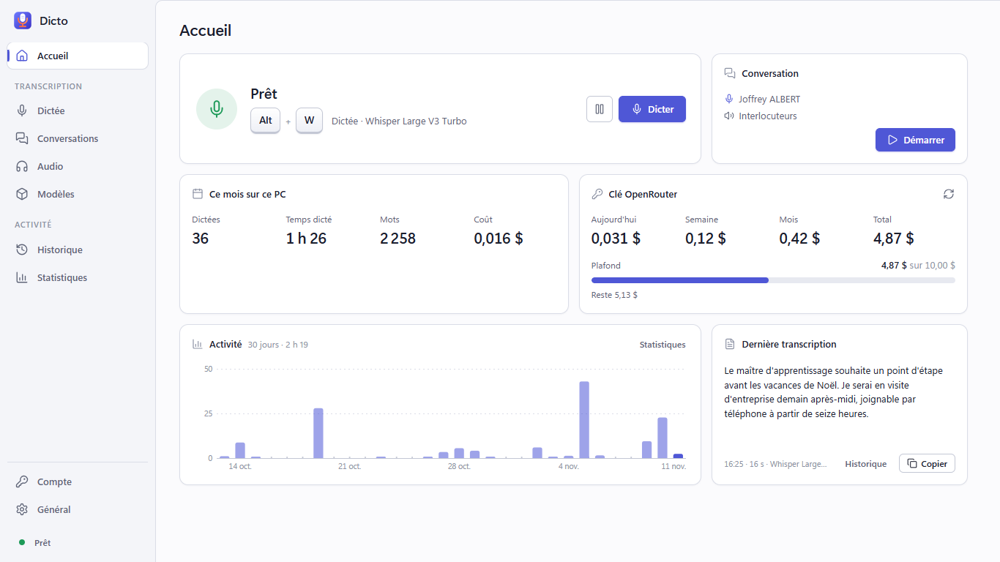
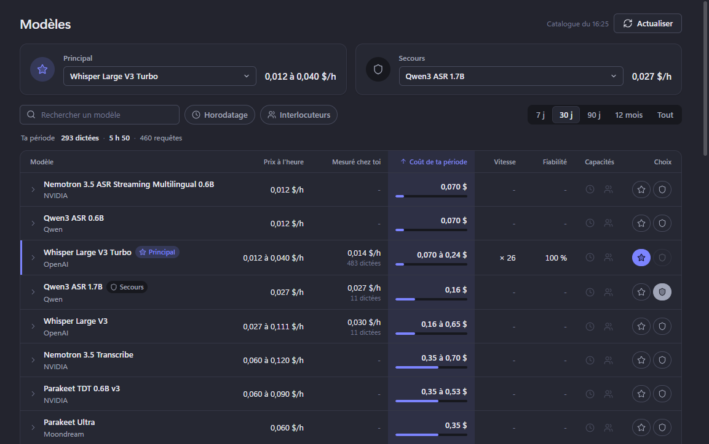
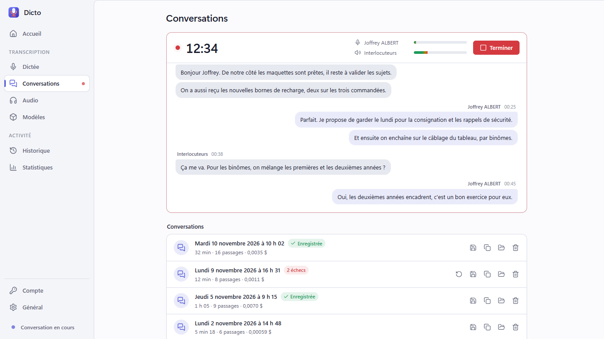
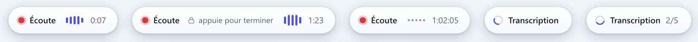

# Dicto

**Dictée vocale pour Windows 10 et 11.** Un raccourci (Alt + W), tu parles, et le texte s'écrit là où tu étais en train
d'écrire : Word, Outlook, navigateur, n'importe quelle application. Il reste aussi dans le presse-papiers.

**[Télécharger Dicto.exe](https://github.com/Gadjoffrey/Dicto/releases/latest/download/Dicto.exe)** (version 2.1.0)

## Installation

1. Télécharge `Dicto.exe` (lien ci-dessus).
2. Double-clique dessus : Dicto s'installe pour ta session Windows, sans droits d'administrateur, avec son raccourci dans
   le menu Démarrer, puis démarre avec Windows (réglable).
3. Colle ta clé OpenRouter dans la page **Compte** (ou reprends celle de ton ancien Dicto en un clic).

Windows peut afficher « Windows a protégé votre ordinateur » pour un fichier téléchargé : clique sur « Informations
complémentaires », puis « Exécuter quand même ». Pour désinstaller : Paramètres de Windows, « Applications
installées », Dicto.

## Ce que fait Dicto

- **Dictée partout** : appui bref sur Alt + W pour écouter jusqu'au prochain appui, appui maintenu pour parler tant que la
  touche est enfoncée ; Échap annule. Aucune durée maximale : les longues dictées sont découpées aux pauses.
- **Transcription de conversation** : clic droit sur l'icône, « Transcrire une conversation ». Ton micro et le son de
  l'ordinateur sont transcrits en même temps, horodatés, puis réunis dans un fichier .md.
- **Coûts clairs** : chaque modèle de transcription ramené au prix d'une heure d'audio, ce que tu as vraiment payé, et
  ce que ta période aurait coûté avec chaque modèle ; consommation de ta clé OpenRouter visible dans la fenêtre.
- **Historique et réécoute** : les dernières dictées se réécoutent et se retranscrivent avec le modèle de ton choix.
- **Tout reste sur ton PC** : réglages, historique, audio et conversations ne quittent pas l'ordinateur (seul l'audio à
  transcrire part chez OpenRouter).
- **Mises à jour** : Dicto te prévient quand une nouvelle version est publiée ; « Télécharger » ouvre le fichier ici.
  Dicto ne télécharge ni ne lance jamais de programme tout seul.

## Crédits

Sons d'interface Material Design de Google, licence [Creative Commons Attribution 4.0 (CC BY 4.0)](https://creativecommons.org/licenses/by/4.0/).

CREATED WITH ❤️ BY ALBERT J. ET UN PEU D'IA
